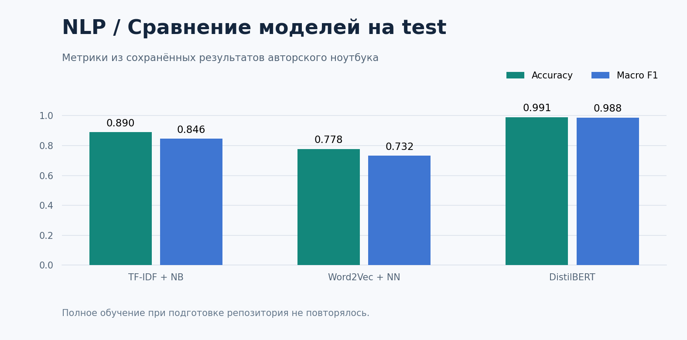

# Text Emotion Classification

**Сравнение трёх подходов к распознаванию шести эмоций в английском тексте.**

Python · Scikit-learn · Gensim · PyTorch · Transformers

NLP-курсовая: единая подготовка корпуса, разделение train/validation/test, настройка моделей, сравнение качества и анализ ошибок. Задача многоклассовая: anger, fear, joy, love, sadness и surprise. Нейтрального класса нет.



## Получить проект

```bash
git clone https://github.com/Ilush1k/text-emotion-classification.git
cd text-emotion-classification
```

## Модели и сохранённые результаты

| Модель | Accuracy на test | Macro F1 на test |
|---|---:|---:|
| TF-IDF + MultinomialNB | 0,8904 | 0,8458 |
| Word2Vec + нейросеть | 0,7776 | 0,7317 |
| DistilBERT | 0,9910 | 0,9875 |

Числа извлечены из присланной автором обновлённой версии ноутбука, а не из повторного обучения при публикации. Они относятся к конкретной выгрузке и разбиению корпуса и не означают такое же качество на любых новых текстах.

## Что сделано

- Проверка пропусков и повторов, очистка ссылок, сокращений и эмоциональных символов.
- Лемматизация и обработка отрицаний для классических признаков.
- Стратифицированное разделение 80/10/10.
- Настройка TF-IDF и MultinomialNB по validation.
- Word2Vec, усреднение эмбеддингов и нейросеть с Dropout.
- Дообучение DistilBERT с весами классов и выбором лучших эпох.
- Macro/weighted-метрики, матрицы ошибок, сравнение времени и пример своего текста.

## Материалы

- [Основной ноутбук с результатами](emotion_classification.ipynb).
- [Данные и источник](data/README.md).
- [Описание эксперимента и ограничений](docs/EXPERIMENT.md).

## Установка окружения Python

Команды выполняются в корне проекта. Рекомендуется Python 3.11.

```bash
python -m venv .venv
```

```powershell
# Windows PowerShell
.\.venv\Scripts\Activate.ps1
```

```bash
# Linux / macOS
source .venv/bin/activate
```

Сначала установите PyTorch для своего CPU/GPU по [официальному установщику](https://pytorch.org/get-started/locally/), затем:

```bash
python -m pip install -r requirements.txt
python -m nltk.downloader wordnet averaged_perceptron_tagger_eng
python -m jupyter lab
```

Версии в requirements взяты из сохранённого окружения автора. Настройка CUDA зависит от видеокарты и драйвера; CPU также поддерживается, но полное обучение нейросетей может быть длительным.

Положите `emotion.csv` в корень или получите совместимый корпус:

```bash
python -m pip install -r requirements-data.txt
python scripts/download_data.py
```

Откройте ноутбук и выполняйте ячейки сверху вниз. `DATA_LIMIT = None` использует весь корпус; для ознакомительного эксперимента можно установить `3000`. Первое получение DistilBERT требует интернета. Готовые веса в репозитории отсутствуют.

В опубликованной копии исправлено определение `imbalance_ratio` в заключении и удалён прежний вывод этой ошибки. Таблицы измеренных результатов сохранены. Полное обучение при оформлении не повторялось.

Автор: [Ilush1k](https://github.com/Ilush1k).
